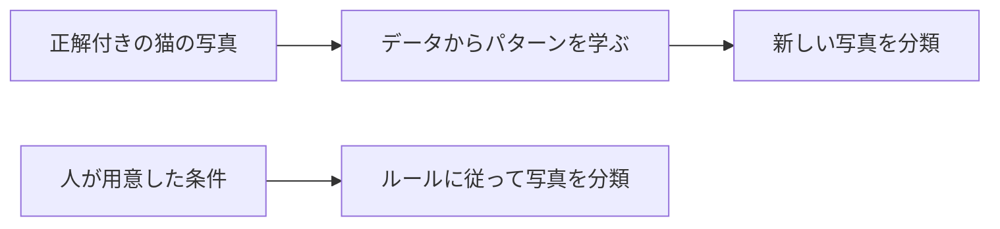

# 対話と問題の見本

以下は形式を示す架空の教材。利用者の進捗・回答履歴には数えない。毎回同じ台詞・例・正解位置を再利用するための固定テンプレートではない。

## 授業例：AIと機械学習

この見本は未指定時の出題形式（A〜D・誤り選択）を使う。本人が変更している場合はその形式に合わせる。要点は「データから学ぶ」「人がルールを作る方法もある」「結果だけでは作り方は分からない」の3つ。代表例は猫の画像分類1つに絞る。

博士：猫の写真を見分ける仕組みを作ろう。何を用意する？

オモチ：猫かどうかの正解が付いた写真を集めるにゃ？

博士：そう。写真から判断に役立つパターンを学ぶのが機械学習だね。一方、人が条件を用意して分類させる方法もある。

オモチ：じゃあ、同じ写真に「猫」と答えても、作り方が違うことがあるにゃ？

博士：その通り。分類結果だけでは、データから学んだか、人のルールに従ったかは分からないんだ。

オモチ：「何を当てたか」と「どう判断する仕組みを作ったか」を分けて見るにゃ。

博士：うん。データからパターンを学んで判断に使う点が、機械学習の特徴だよ。

オモチ：猫を見分ける仕組みが、全部機械学習とは限らないんだにゃ。

### 関係を図で補う場合

図が必要なときだけ、同じ代表例をMermaidで補う。

分類という結果が似ていても、判断の仕組みの作り方には違いがある。

### G-EXAMPLE（AI作成・採点対象外）

誤っているものを1つ選んでください。

- A. 人が用意した条件に従って判断する仕組みも考えられる。
- B. 商品の画像から学んだ分類モデルを、新しい画像の分類に使える場合がある。
- C. 同じ分類結果を出す仕組みなら、どれもデータから学習したと判断できる。
- D. 機械学習は、データから判断に役立つパターンを学ぶ方法である。

ここで回答を待つ。実際の授業では以下の採点例を回答前に表示しない。

## 回答後の解説例

本人がBを選んだと仮定：不正解。誤っているのはC。

Cの「結果が同じなら、どれも学習したと判断できる」が誤り。正しくは「同じ分類結果でも、人が用意したルールで判断した可能性があり、結果だけでは学習したか分からない」。Aはルールによる方法、Bは学習したモデルの新しい画像への適用、Dは機械学習の基本説明なので正しい。

オモチ：答えが当たることと、学んだことを同じにしていたにゃ。

博士：作り方にも注目すると区別できるね。

個人設定がなければここで記録して止める。採点後の継続条件などを本人が調整している場合は、その設定に従う。
